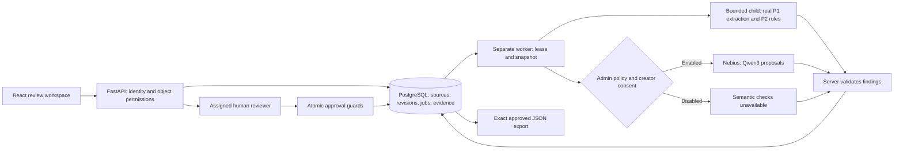

# BrandGuard implementation architecture

S6 record, 23 October 2026. Implementation baseline: `b5999b23f7a050e525395d0f49b25e41f5bc42c9` (`s5 done`). This describes repository behaviour; the production topology is still proposed.

## Data flow

## Component contracts

| Component | Implemented responsibility | Boundary |
|---|---|---|
| `apps/web` | Sessions, source curation, pasted-text intake, revision editing, processing consent, actual run polling and findings | D3–D6 interaction/approval screens and integrated browser evidence remain team work. Labelled demo examples are distinct from live run results. |
| `apps/api/brandguard` | All authoritative permissions, source activation, revisions, enqueue, model validation, workflow, governance and export | Client-supplied roles/tenant IDs do not authorise object access. |
| `packages/review_engine` | P1 text/document/image extraction and P2 deterministic checks | Library format support does not establish an authenticated upload API. Runtime bridge currently accepts pasted text. |
| `apps/worker` | P3 polling daemon and graceful shutdown, using the API's claim/process boundary | No independent database writer or duplicated model-validation policy. |
| PostgreSQL | Durable queue, immutable evidence, tenant-constrained relationships and concurrent state guards | Application-scoped permissions, not PostgreSQL row-level security. Backups/restore are not yet verified. |
| Nebius Token Factory | Optional semantic proposals referencing supplied approved rules | External processing; no approval authority, tools or publishing access. Semantic correctness requires human judgement. |

## One review, end to end

1. A manager creates a source version with literal quotes and structured rules. Activation locks the brand, checks the expected source epoch, validity/conflicts and retirement rationale. Past source evidence stays immutable.
2. A creator creates an LF-normalised revision. SHA-256 covers its exact canonical UTF-8 text, including whitespace. New revisions require the current parent ID. Reviewers are separate workspace memberships.
3. Analysis submission stores a run, active/effective source snapshot, job and audit event in one transaction. An idempotency key prevents duplicate submission. Processing policy/consent is frozen for the run.
4. A worker claims using `FOR UPDATE SKIP LOCKED`, a random lease token, a 65-second lease and a three-attempt bound. Completion requires the same unexpired lease. The 60-second review deadline includes queue age; stale queued work may therefore finish incomplete.
5. Real P1/P2 checks run in a child with a 10-second wall timeout, 5 CPU seconds and 384 MiB address-space limit. Input/output bounds are 2 MB/512 KiB. The child receives no database/provider credentials. These resource limits do not constitute a complete OS security sandbox.
6. The structured text checker covers terminology and trial duration. Unsupported fact kinds remain manual. Pasted text supplies no image or colour-pair evidence, so visual/accessibility are explicitly not applicable to this input.
7. External processing requires both current admin policy and revision-specific creator consent. The model receives canonical text, campaign context and eligible approved rules. The adapter enforces input bytes, output size, timeout and daily request reservations. It has no automatic fallback.
8. Schema, source/rule pairs, literal evidence, unique content quotes and edit constraints are validated. Server policy assigns category/severity/evidence status from the cited rule. Model failures preserve deterministic findings and visible incomplete checks. A structurally valid citation still may be a semantic false positive.
9. Comments, reasoned resolutions and manual-check attestations are recorded separately. Only the assigned separate reviewer can approve. Approval locks state and rechecks workflow version, exact revision, run, sources, check completion and blockers; decision and audit commit together. An exception is not evidence that a claim is true.
10. Export repeats freshness/permission guards and returns the exact approved revision/hash, source snapshot and decision evidence. Edits create a new draft; source activation/expiry can make approval stale. A stale approval cannot authorise a new export.

## Identity and processing boundaries

Passwords use Argon2. Eight-hour opaque session tokens and CSRF values are stored as hashes; cookies are HTTP-only, SameSite Strict and Secure outside development. Mutations check the exact configured browser origin and CSRF header. Login throttling is database-backed. Production requires an HTTPS origin. Local Vite development uses `PUBLIC_ORIGIN=http://localhost:5173` and the Vite `/api` proxy.

The current role model has one role per workspace membership. Tenant constraints and API queries scope objects; creators see their own content, reviewers assigned content, managers workspace content. Admin processing policy is distinct from manager source activation and reviewer decisions. Endpoint contracts are published in `contracts/openapi.json` (API 0.5.0; database head `0004_workflow`). Package versions are separate from API contract versions.

## Operational limits and deployment work

The planned same-origin deployment is Caddy + static SPA + API + worker + persistent PostgreSQL on a team-controlled host. No `infra/` deployment, verified public URL, encrypted-backup evidence or restoration record exists at this baseline. API readiness checks schema/DB, not worker heartbeat or model health. A worker heartbeat, proxy-aware client identification, operational monitoring, private uploads, retention/deletion and backup expiry still need implementation/verification.

See [S5 evidence](S5_HANDOFF.md), [disclosures](DISCLOSURES.md), [feature status](COMPLETED_FEATURES.md) and [submission coordination](SUBMISSION_STATUS.md). None of these documents establishes deployment readiness.
