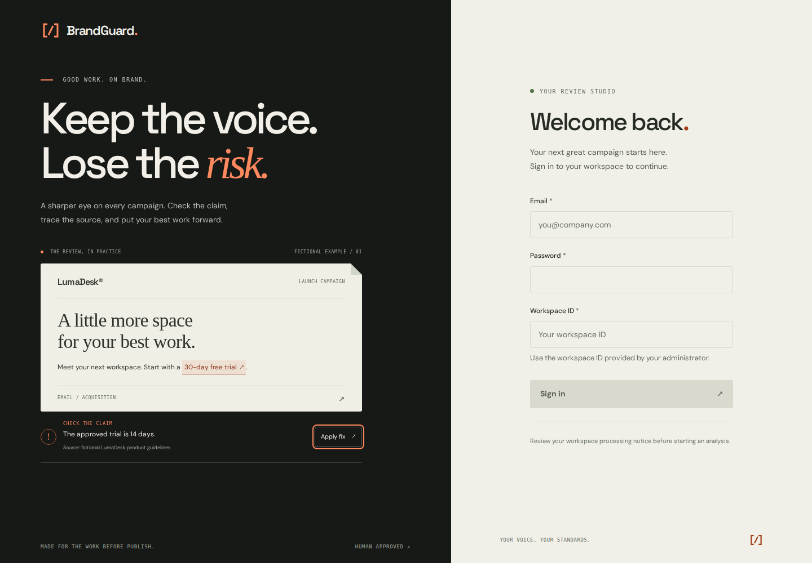
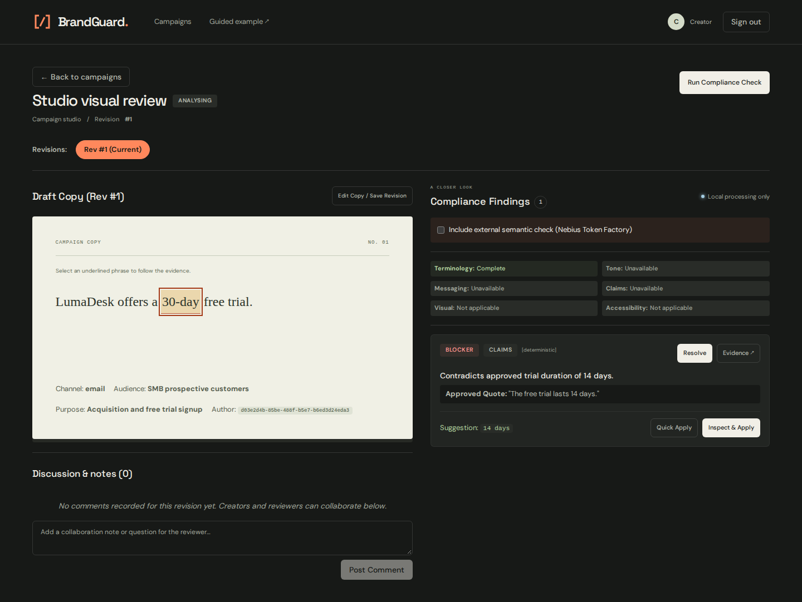

# BrandGuard review studio

The interface now uses a graphite frame, warm paper document surfaces, orange actions, and editorial typography. Login includes a clearly fictional, interactive correction example. On mobile, sign-in appears before the demonstration, including in keyboard order.

The campaign overview leads with real campaigns and the brand library. The review workspace separates the document from findings and source evidence, keeps category coverage visible, and supports narrower screens. Shared forms, dialogs, navigation, status colors, and the favicon follow the same visual system. Motion respects reduced-motion preferences. No additional runtime dependencies were added.

Route changes reset scroll position. Cancelling a draft edit restores the text, channel, audience, and purpose from the selected revision.

## Validation

- TypeScript production build and ESLint pass.
- Existing four browser tests pass against the real API and worker, including review, exact revision approval, export, and manager insights.
- Two additional browser tests cover the sample interaction, keyboard order, document edit cancellation, evidence drawer, accessibility, and reflow at 375, 768, 1024, and 1440 pixels.
- Automated accessibility checks are scoped to the tested pages and states; they do not establish full WCAG conformance.

The browser tests use the existing disposable synthetic workspace described in [the browser verification guide](../tests/e2e/README.md).

```sh
cd apps/web
npm run build
npm run lint
npx playwright test e2e/workflow.spec.ts e2e/studio.spec.ts --reporter=line
```

## Previews

These screenshots use fictional demonstration or synthetic browser-test content.




