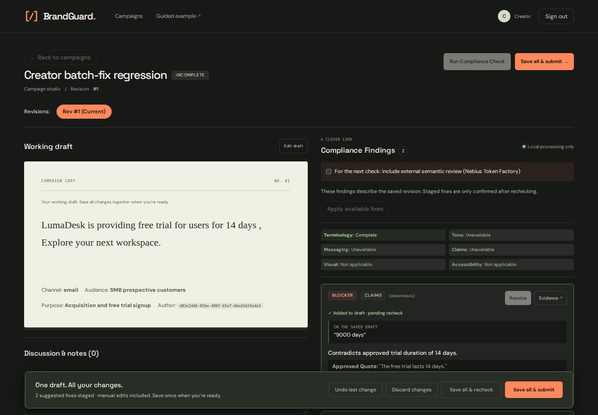

# Batch corrections and creator review UX

Reproduction: `lumadeks is providing free trial for users for 9000 days , OH MY GOD THIS IS INSANE!!!`

## Findings from the current implementation

- Terminology checks cover canonical casing and configured forbidden variants, but not an adjacent-letter transposition such as `lumadeks`.
- Trial-duration detection requires the duration immediately beside a narrow set of trial phrases. `trial for users for 9000 days` falls outside that grammar.
- Suggested edits use positions in the analysed revision. After one change, the UI rejects every subsequent suggestion because the working text no longer equals that revision.
- Saving clears results without automatically checking the new revision. Submission failures expose workflow details instead of telling creators what to do next.
- The proposed-edit dialog displays the guideline quotation as if it were the text being replaced.

## Implementation sequence

1. Add narrowly bounded, source-backed likely-typo detection for approved single-word brand names, including one adjacent transposition. Keep probable typos advisory rather than claiming certainty. Broaden trial grammar without treating unrelated refund or onboarding durations as trial claims.
2. Track a working draft and chronological Unicode-aware changes. Project finding ranges through previous changes. Apply several independent suggestions in any order, including after manual edits elsewhere. Reject overlaps and duplicate application. Provide undo and discard.
3. Keep the analysed findings beside the live draft. Mark staged suggestions as pending recheck, and explain unavailable or overlapping suggestions. Provide an optional batch action for applicable fixes.
4. Save the whole draft as one revision, automatically recheck it, and offer a save-and-submit path that opens the submission confirmation only after checking. Keep backend approval, coverage, source-freshness, and reviewer gates intact. Explain incomplete checks before submission; never replace a missing run ID with a fabricated one.
5. Test the exact sentence, typo false positives, numeric subject binding, UTF-16/Unicode differences, changing edit lengths, overlaps, undo, one persisted revision for multiple fixes, and the existing approval/export workflow.

Tone and messaging remain semantic or explicit human checks. Local spelling and structured duration checks do not certify semantic coverage. Existing external-processing consent still applies to each new analysis request.

## Delivered behavior

- `lumadeks` is flagged as a possible misspelling of the approved brand/product name; `9000 days` is linked to the approved trial duration. Likely spelling matches stay advisory.
- Apply or customize multiple fixes, type edits elsewhere, undo the last text change, or discard the batch. Remaining locations follow earlier edits; overlapping passages require a recheck.
- The persistent draft bar offers **Save all & recheck** and **Save all & submit**. Both create one revision for the batch. The submit action waits for the new analysis before opening confirmation.
- A failed recheck preserves the saved revision and can be retried without creating another one. Missing category coverage and unresolved blockers are explained before submission.
- Source quotations and draft passages are shown separately. Staged fixes are explicitly pending recheck.

## Validation

48 Python tests pass across the review engine, bridge, evidence validator, and worker. Eleven Playwright tests pass across draft edits, real creator/reviewer batch corrections, recheck recovery, responsive layouts, accessibility, and the existing exact approval/export workflow. The regression flow asserts zero revision writes while applying fixes, one write for the combined changes, and one eventual submission after required coverage.

